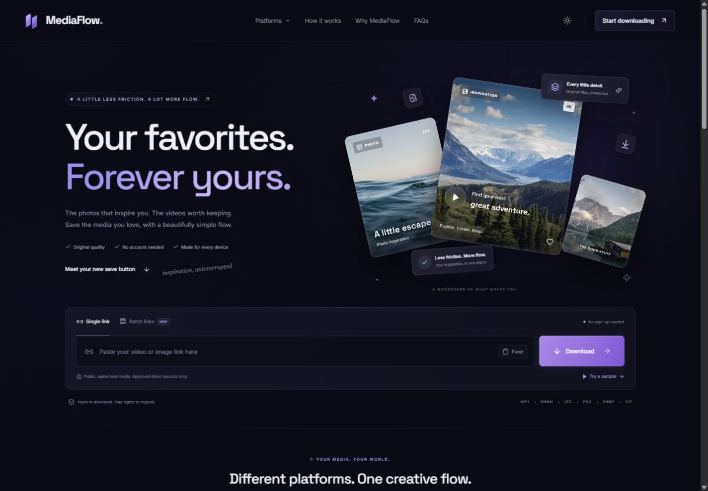

# MediaFlow

A cinematic, responsive media downloader with a React interface and a separately hosted, restricted Express API. Midnight surfaces, violet light, cyan details, editorial typography, and thoughtful motion make a practical workflow feel considered.

**Real files. Honest compatibility.** MediaFlow resolves public video-page links through a real yt-dlp integration and downloads publicly reachable direct image/video files. It offers actual available MP4/WebM qualities, preserves source audio when available, and merges compatible separate tracks locally without transcoding. Known silent formats are labeled “video only”; unknown audio metadata is left unclaimed. Platform availability depends on what the source exposes to the hosting server; private, protected, removed, and blocked content returns an explicit error.

**Paste normal public video links from YouTube, TikTok, Instagram, Facebook, Pinterest, Reddit, and X.** Watch pages, supported video posts, and share links go through the real extractor. If a platform requires login, blocks the server, or exposes no complete supported media, MediaFlow reports that outcome. Photo files work through direct image URLs; image-only post pages and galleries are not presented as supported video downloads.



## Included

- Responsive homepage, floating media showcase, downloader, platform compatibility, three-step guide, feature cards, FAQ, and legal pages.
- Dark and light themes, Motion for React entrances and reveals, restrained CSS lighting, hover details, and reduced-motion support.
- URL validation, clipboard paste, real server-backed metadata, image/video previews, actual quality selection, truthful audio labels, supported-source batch processing, cancellation, friendly errors, and retry.
- Progress based on received bytes when the server exposes a useful content length. No invented percentage when it does not.
- MP4, WebM, JPG, PNG, WebP, and GIF handling. A quality selector reflects variants actually supplied by the source; direct-file sources expose their original variant.
- Public-IP checks, DNS-pinned outbound requests, guarded extractor egress, Deno with denied network/file/environment permissions for challenge code, offline FFmpeg processing, optional exact-host restriction, size/time limits, safe attachment headers, rate limits, and restricted CORS.
- TypeScript workspaces, automated checks, GitHub Pages deployment, a Render API blueprint, environment examples, and operational documentation.

## Start locally

Install Node.js 22.12 or later in the Node 22 release line, Python 3.10+ (3.11+ recommended), and FFmpeg with FFprobe. Run commands from this repository's root. Automatic extractor/runtime installation supports Windows x64 and Linux x64.

```sh
npm ci
```

Copy `server/.env.example` to `server/.env` and `client/.env.example` to `client/.env` using your file manager or shell. Keep the sample localhost values for development. On Windows, set `PYTHON_PATH` and `FFMPEG_PATH` to your executables if they are not on PATH. Install the pinned yt-dlp and Deno tools, check the runtimes, and start the app:

```sh
npm run setup:media --workspace server -- --check-runtime
npm run dev
```

Open the Vite URL printed in the terminal, normally `http://127.0.0.1:5173`. Both `http://localhost:5173` and `http://127.0.0.1:5173` are allowed by the development API configuration. The API listens on `http://localhost:8787`; its health endpoint is `http://localhost:8787/api/health`.

The downloader needs the API running. If the API is unavailable, the interface reports the connection problem. The showcase is decorative; it never impersonates a resolved result.

Try the labeled sample in the downloader: [Big Buck Bunny on Internet Archive](https://archive.org/details/BigBuckBunny_328). This is a real video-page link; the resolver finds its available MP4 file with video and audio. Sample credit: © 2008 Blender Foundation, [CC BY 3.0](https://creativecommons.org/licenses/by/3.0/), hosted by Internet Archive. Preserve the film's credits when sharing it. Third-party availability can change; an upstream error remains visible rather than producing simulated media. Use media you own or have permission to download.

The installer downloads official release artifacts, verifies their tracked SHA-256 checksums before installation, and reuses matching local files. It does not run a downloaded installer script or install global Python packages. `server/.tools-version.json` pins the exact releases; generated binaries stay out of Git. FFmpeg is required for public video-page results: it verifies the video stream and any promised audio, and combines separate tracks when needed. Unknown progressive audio metadata does not cause a valid source file to be rejected.

## Repository map

```text
mediaflow/
├── client/                    React, Vite, TypeScript, Tailwind, Motion
│   ├── public/                Static brand and SEO assets
│   └── src/                   Routes, components, styles, API client
├── server/                    Express API, source adapters, secure fetcher
│   ├── scripts/               Checksum-verified media-tool setup
│   ├── src/
│   └── tests/                 Security and API regression tests
├── docs/
│   ├── DESIGN.md              Visual system and architecture
│   ├── DEPLOYMENT.md          GitHub, Pages, Render, domains, operations
│   └── TESTING.md             Automated checks and manual acceptance
├── .github/workflows/         CI and Pages deployment
├── render.yaml                Independent Node API deployment
└── package-lock.json          Shared reproducible dependency lock
```

## Commands

| Command | Purpose |
| --- | --- |
| `npm run dev` | Start frontend and API development servers |
| `npm run setup:media --workspace server -- --check-runtime` | Install pinned yt-dlp/Deno and verify media runtimes |
| `npm run check` | Check TypeScript across both workspaces |
| `npm test` | Run the repository's automated tests |
| `npm run build` | Build frontend and API |
| `npm run build:client` | Produce `client/dist` for static hosting |
| `npm run build --workspace server` | Produce the server distribution |
| `npm run start --workspace server` | Start the compiled API |

## Supported sources

| Input | Result |
| --- | --- |
| Public direct HTTPS image/video URL | Resolve, preview, and download its original file after network/content validation |
| Supported formats | MP4, WebM, JPG/JPEG, PNG, WebP, GIF |
| Public single-video page, including supported social platforms and video hosts | Real extraction; available direct MP4/WebM qualities with source-based audio labels |
| Video-only quality plus a compatible separate audio track | Both tracks fetched securely by Node, then merged by offline FFmpeg |
| Explicitly silent source with no compatible audio track | Downloadable and labeled “video only” |
| Progressive source with unknown audio metadata | Original source retained, including any audio actually present; no audio claim invented |
| Private IP, local address, protected URL, or unsupported content | Explicit rejection |
| DRM, login-required content, live streams, playlists/channels, or a hosting-IP block | Unsupported; the service does not bypass access controls |
| Photo gallery/post page without a downloadable video | Not a gallery scraper; use an authorized direct image URL |

`ALLOW_PUBLIC_MEDIA=true` enables validated media on public HTTPS hosts. Set it to `false` to restrict input and direct-media requests to `ALLOWED_MEDIA_HOSTS`; that list defaults to `images.unsplash.com`, `upload.wikimedia.org`, `media.w3.org`, and `interactive-examples.mdn.mozilla.net`. Restricted mode can prevent platform-page downloads unless their page and media hosts are deliberately configured. Network eligibility is not a license grant; check each file's license and provider terms.

The service does not transcode, upscale, strip watermarks, invent missing audio, or promise qualities the source does not provide. Only unencrypted direct HTTP media tracks become download plans; manifest-only formats are not offered. An extractor supporting a platform does not guarantee every link works. Cloud-host IPs may receive source-side bot checks or restrictions, and no cookies, login credentials, proxy rotation, or DRM bypass is provided.

## Configuration

Frontend settings are compiled into public JavaScript. They must never contain secrets.

| Setting | Development example | Meaning |
| --- | --- | --- |
| `VITE_API_BASE_URL` | `http://localhost:8787/api` | API base, including `/api` |
| `VITE_BASE_PATH` | `/` | Asset base; use `/mediaflow/` for a project Pages URL |
| `VITE_SITE_URL` | `http://localhost:5173` | Canonical public site URL, including project path if any |

The API's `.env.example` lists server settings. `ALLOWED_ORIGINS` contains exact frontend origins, without a path or trailing slash. `ALLOW_PUBLIC_MEDIA` controls public-host access; `ALLOWED_MEDIA_HOSTS` supplies exact hostnames for restricted mode. `EXTRACTOR_ENABLED=false` disables video-page resolution. Runtime paths are `EXTRACTOR_PATH`, `PYTHON_PATH`, `DENO_PATH`, and `FFMPEG_PATH`; Python and FFmpeg can be set to absolute executable paths. The extractor defaults to `server/.bin/yt-dlp` and its adjacent Deno executable.

## API and extensions

| Endpoint | Purpose |
| --- | --- |
| `GET /api/health` | Service health |
| `GET /api/platforms` | Platform identity and truthful compatibility |
| `POST /api/resolve` | Resolve `{ "url": "https://example.com/video-page-or-media-file" }` |
| `POST /api/batch` | Resolve `{ "urls": ["https://example.com/video"] }`; 1–5 input URLs, deduplicated |
| `GET /api/media/:id?format=FORMAT_ID&disposition=inline` | Preview an actual returned format for an unexpired opaque ID |
| `GET /api/media/:id?format=FORMAT_ID&disposition=attachment` | Save the selected file, preparing audio/video tracks if necessary |

Use an ID from the resolve response's `formats` array; direct files use `original`. Batch results preserve per-source success or error details. A media ID is a temporary reference, not persistent storage. New integrations must reuse the network restrictions and expose only real available variants. The [design and architecture guide](docs/DESIGN.md) explains responsibilities and extension boundaries.

## Publish in GitHub

Push this directory as the **repository root**, including `.github`, `client`, `server`, `package.json`, and `package-lock.json`. The repository includes workflows; it does not contain GitHub credentials or claim to have created a remote repository.

1. Create an empty GitHub repository named `mediaflow` (or choose another name).
2. Upload or push the complete source directory.
3. Deploy `render.yaml` as a Render Blueprint and set the frontend origin when prompted.
4. Add GitHub repository variables `API_BASE_URL` and `SITE_URL`; set `BASE_PATH` if needed.
5. In repository **Settings → Pages**, choose **GitHub Actions** as the source.
6. Run the **Deploy frontend to GitHub Pages** workflow or push to `main`.

The deployment job waits until `API_BASE_URL` and `SITE_URL` are configured; ordinary CI still runs on the first push. Once configured, the workflow checks, tests, builds, uploads `client/dist`, and deploys it to the `github-pages` environment using the documented GitHub Actions approach. See the full [deployment guide](docs/DEPLOYMENT.md) for exact values, commands, custom domains, and troubleshooting. [GitHub's custom workflow documentation](https://docs.github.com/en/pages/getting-started-with-github-pages/using-custom-workflows-with-github-pages) describes the required deployment permissions.

GitHub Pages hosts the frontend. A Node host runs the API. Without a deployed API and matching CORS origin, the hosted downloader cannot resolve or download files.

## Before a public launch

Run the [acceptance checks](docs/TESTING.md) against the actual deployed URLs. Set your site's canonical URL, operator information, support channel, privacy terms, production limits, and permitted source policy. Review source-host permissions and operational capacity for your own deployment.

The default resolver registry, preparation cache, and rate limiter are process-local. Use one API instance with these defaults; restarts expire previews. Horizontal scaling requires shared state and coordinated temporary storage. Prepared videos use bounded temporary disk space and expire with their media IDs. Browser downloads buffer the permitted file in memory, so choose a lower cap for a mobile-heavy audience. CORS limits browser access; it is not API authentication or protection from non-browser clients. See [operations and limits](docs/DEPLOYMENT.md#operations-and-limits).

## License

Application code is MIT licensed. yt-dlp, Deno, FFmpeg, external media, platform names, trademarks, and fonts retain their respective licenses and rights. Downloaded tool binaries and sample media are not included in the application's MIT license.

